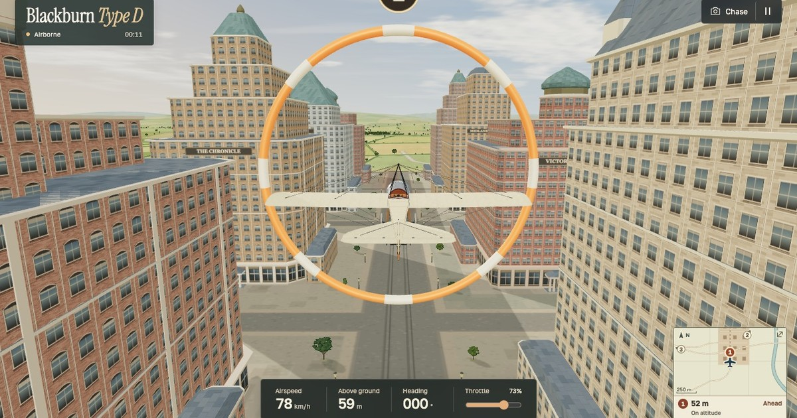

# Blackburn Type D

[Fly in your browser](https://blackburn-flight.andreydunaev1.workers.dev/) · [Download the offline simulator](https://github.com/Dun4ev/blackburn-flight/releases/latest/download/Blackburn-Flight.html) · [Andrej Dunaev’s portfolio](https://dun4ev.com/)

Fly a 1912 Blackburn Type D through four rings to discover photographs and stories of the surviving aeroplane. Start in the tower district, follow the mini-map, and select a chapter when you want to pause and read. English and Russian, with keyboard and touch controls.

[Start in flight on approach to the first ring](https://blackburn-flight.andreydunaev1.workers.dev/?fly=1).



Built with GPT-6.2 Astra. Andrej Dunaev created the project using OpenAI Codex, Blender and Three.js. This is an interpretive reconstruction with a fictional landscape and simplified flight dynamics. The [photograph credits](assets/history/CREDITS.md) identify the photographers and the licences of the images.

## О симуляторе

Редактируемая реконструкция моноплана Blackburn 1912 года и браузерный симулятор свободного полета. Откройте `outputs/Blackburn-Flight.html` в современном браузере на базе Chromium с поддержкой WebGL 2. Модель, шрифты и ландшафт встроены в HTML. Файл работает локально без сервера и подключения к интернету.

На первом экране можно повернуть самолет, рассмотреть каркас и выбрать место старта. Кнопка клавиатуры открывает подсказку по управлению. На сенсорном экране доступен виртуальный джойстик. Аэродинамика игровая, местность условная.

В полете мини-карта показывает направление и расстояние до выбранного кольца. Нажмите на нее или клавишу `M`, чтобы открыть карту всего маршрута и выбрать другую точку. После пролета через кольцо появляется карточка главы с фотографией и коротким текстом. Нажатие открывает главу на вкладке истории и ставит полет на паузу.

## Файлы

- `outputs/Blackburn-Type-D.blend` - модель и студийная сцена для Blender 5.2. Рядом находится PNG с общим видом.
- `work/aircraft.glb` - модель для веб-сцены. В той же папке находятся исходники симулятора, скрипты моделирования и проверки.
- `assets/history` - четыре фотографии G-AANI, авторство и лицензии в `CREDITS.md`. Тексты глав и каталог источников находятся в `work/heritage.js`.
- `assets/fonts` - шрифт Golos Text и его лицензия. Сборка встраивает в HTML лицензии обоих шрифтов и Three.js.

## Сборка

Понадобятся Node.js 20 или новее, npm и Python 3 с командой `python3`. Запустите эти команды в корне репозитория.

```sh
npm ci
npm run build
```

Сборка использует готовый GLB и записывает `outputs/Blackburn-Flight.html`. Для записи в другой файл передайте `--output`, например `npm run build -- --output work/flight-preview.html`.

Для публикации на статическом хостинге выполните `npm run build:site`. В `dist/` будут `index.html` и изображение для предпросмотра ссылки. Процесс публикации на Cloudflare Workers Static Assets использует только этот каталог.

## Проверка

```sh
npm test
npm run test:browser
```

Первая команда проверяет динамику полета и пересечение колец. Вторая запускает установленный Google Chrome через Playwright и проходит сценарии на настольном и сенсорном экранах с отключенной сетью. Для проверки своей сборки укажите путь после `--`, например `npm run test:browser -- work/flight-preview.html`.

Для проверки исторических глав и полетного маршрута в Chrome запустите `npm run test:journal`.
